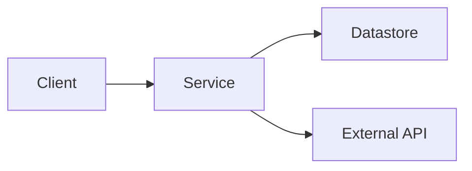
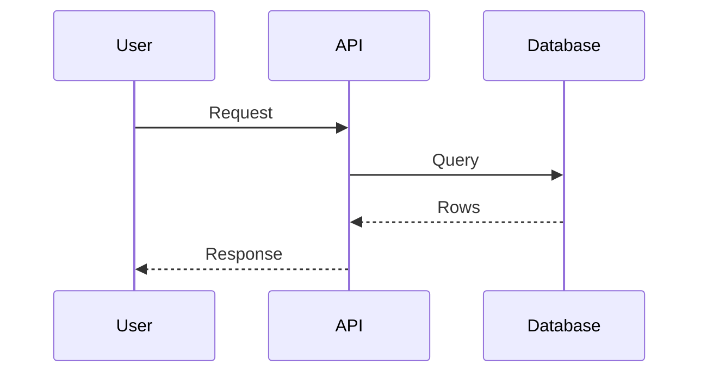

# RFC Format

An RFC is a **reviewer-facing design doc**: enough for a reviewer to judge the design in one sitting, and no more. The [template](#template) below is the canonical format. Each `<aside>` in it is the instruction for its section; the opening callout holds the rules for the whole doc.

## Writing the draft from the template

- **Asides are instructions, not content.** Follow each one, then leave every aside, the opening callout included, out of the draft.
- **Sections.** Always write the required five: TL;DR, Problem Statement, Solution Overview, Key Decisions, Alternatives Considered. Add an opt-in section only when it passes the callout's test, and drop an omitted section's heading entirely. Leave out Changelog; the draft is in *Draft*.
- **Page header.** Open with the title `RFC-NNN <short title>`, keeping `NNN` for the user to number, then a properties block: **Lead**, **Reviewers**, **Tags**, **Linear**, **Status**: Draft, **Comments Due**. Fill what the session established and leave the rest blank for the user. These, and `NNN`, are the only placeholders the draft may carry.
- **Permalinks.** Link code as `https://github.com/<owner>/<repo>/blob/<sha>/<path>#L<start>-L<end>`, using a commit the remote already has (`git branch -r --contains <sha>` is non-empty). When that commit is not on the default branch, say which branch the RFC anchors to directly under the TL;DR.
- **From the session to the sections.**
  - **Key Decisions**: the ledger's decisions a reviewer would relitigate. The pick is the chosen option, the trade-off accepted comes from its cons, and the runner-up is the strongest option not picked.
  - **Alternatives Considered**: the approaches from the Phase 1 approach question that were not chosen, each with why it lost and what would reopen it. Write each as a bullet with its detail indented beneath, as the template shows; the editor turns it into a toggle.
  - **Risks & Open Questions**: deferred decisions become open questions.
- **Doubt.** When the right call on scope, depth, or a section is unclear, ask the user through the terminal's structured tool.

## Template

````md
<aside>
📝

**This doc must be readable in one sitting.** Every section states a budget; treat it as the target, and go over only when the extra is information a reviewer needs to judge the design, not explanation. Include a section only when it tells a reviewer something they need in order to judge the design and can't get from the Linear project, the PRD, or another section — an omitted section beats a thin one. Lead with diagrams, schema sketches, and one-line bullets; spend prose only on *why*. Reviewers can always ask for more. If in doubt, ask the user working with you (agent) on authoring the RFC.

**Required:** TL;DR, Problem Statement, Solution Overview, Key Decisions, Alternatives Considered. Everything else is opt-in.

**Link code, don't describe it** — always as permalinks. If the RFC anchors to a branch other than the default, say so up front.

Title this page **RFC-NNN <short title>** (next number in the list). Set **Lead**, **Reviewers**, **Tags**, and **Linear**; **Status** is *Draft* now and *Open for Comment* when ready for review. Set **Comments Due** to about 2-3 business days for project- or pod-scoped designs; give it at least a week when you want the whole org's input, and post it in #rfc in that case — the page emoji and title as one bold link, the TL;DR, then **Comments due: <date>** on its own line. When review converges, the Lead sets *Adopted*. Once *Open for Comment*, record every material change in the Changelog. Delete this callout once you're set up, and delete the prompts for each section when adding them.

</aside>

## TL;DR

<aside>
💡

Required. One or two sentences: what this RFC will do and why. A reader who stops here should understand what the proposal is about and be able to decide if they want to read on.

</aside>

## Problem Statement

<aside>
💡

Required. No more than 3–6 sentences: the problem, who it affects, and why now. Link current code (*permalink*) rather than describing it. Add **Goals / Non-goals** only when scope needs pinning; make goals measurable. Don't restate the PRD or ticket — the **Linear** linked in the RFC record carries that context.

</aside>

- **Goals:**
- **Non-goals:**

## Solution Overview

<aside>
💡

Required. **One diagram** of the overall shape — components, boundaries, who talks to whom — sized to fit the page width (`LR` up to about five nodes across, `TB` beyond that; put detail in a supporting diagram rather than widening this one), plus at most one short paragraph. A reviewer should get the design from this section alone.

</aside>



## Key Decisions

<aside>
💡

Required, 1–5. Only the choices a reviewer would otherwise relitigate: the pick, the why, the trade-off accepted, and the runner-up inline — *instead of X, because Y*. One bullet each; an H3 only when a decision needs its own diagram. Whole-approach roads not taken belong in **Alternatives Considered**, not here.

</aside>

- **<Decision>** — why; trade-off accepted. *Instead of <runner-up> — one line on why not.*

## Design

<aside>
💡

Optional. Keep only the subsections that add something the overview doesn't. Sketches, not implementations — the shape of schemas, interfaces, algo outlines, not fully working code; exact numbers, config keys, library behavior, and code references are part of a sketch, not implementation detail. The diagram types named below are suggestions: use whatever shows the idea best, one diagram per idea, sized to the page width. Link existing code instead of restating it.

</aside>

### Key Flows

<aside>
💡

One sequence diagram per core flow — designs usually have several (subscribe, notify, reconcile…), and each earns its own. Put failure paths in `alt` branches inside the flow they belong to. Show who talks to whom and in what order, not every call — a diagram that reads like the code is too much.

</aside>



### Data & Schema

<aside>
💡

GraphQL-first: sketch new or changed types, queries, mutations, and subscriptions in a `graphql` block. An ER diagram to show relationships: existing entities as bare boxes for context, new entities and fields in full.

</aside>

```graphql
type Example {
  id: ID!
}
```

### Components

<aside>
💡

What's new, what changes, what stays — and where each lives (permalinks). Include a class/relationship diagram the same way as the ER guidance above when there are relationships worth showing. Use C4 component-level conventions where they fit; at minimum, label relationships with what they do, not ‘has’ or ‘relates to’.

</aside>

### External Interfaces

<aside>
💡

Events, webhooks, file contracts, public API surface — anything other teams or customers depend on.

</aside>

## Alternatives Considered

<aside>
💡

Required. Approach-level roads not taken — including *do nothing* when it was a live option. One toggle per alternative, one line per part: what it was, why not, what would reopen it. Genuinely considered none? Say so in one line — that's a claim reviewers can challenge.

</aside>

- **Alternative A** — one-line summary
    
    Why it was considered; why it was rejected; what would reopen it.
    

## Risks & Open Questions

<aside>
💡

Optional. Live risks with the mitigation in the same line; open questions as checkboxes. Resolve a question by folding the answer into **Key Decisions** and ticking it — no dated decision/change log while in *Draft*.

</aside>

- [ ]  <Open question>

## Verification & Rollout

<aside>
💡

Optional — expected for project designs, usually omitted for process or technology-directional RFCs. How we prove it and ship it is part of the design. Don't state the standard (unit tests, an e2e pass); list the specific scenarios, one line each — what it exercises and what that proves — so the list doubles as a checklist against the implementation.

</aside>

- **Test approach:** the scenarios, one line each; load or soak tests if scale is in question.
- **Rollout:** feature flags, staged or gated release, data migration and backward compatibility, rollback if non-trivial.
- **Observability:** the metrics, monitors, alerts, dashboards, and runbooks this needs to be operable on day one.

## Plan of Attack

<aside>
💡

Optional — when the work splits into several chunky pieces, and important when order matters: phases that gate each other, a migration that must precede a cutover, a dependency on other work.

List at phase/milestone level with one line description. This is **not** a detailed implementation plan — that lives in project milestones/tickets and then more detailed in AI-assisted step-by-step plans during actual implementation.

</aside>

1. **<Phase/milestone>** — one line.

## Action Items

<aside>
💡

Optional — process items not covered by existing Linear planning: research to finish, an owner to assign, a decision to chase. Never "implement this" — that lives in Linear.

</aside>

- [ ]  <Item — owner, can be added later if unknown>

## Changelog

<aside>
✍️

Once Open for Comment, add an entry per revision — an H3 with the date and who, then one line per material change and why — so returning reviewers can see what was incorporated. A revision that answers a round of feedback is one entry, not one row per change. Nothing while in Draft.

</aside>

### YYYY-MM-DD — <who>

- <What changed and why>

## References

<aside>
💡

Optional. Related RFCs (@-mention them), prior art, designs, prototypes, key code (permalinks). The gate: does it support a decision made here, cover similar ground, or give the reader something to jump straight into? Repeating a link that also lives in Linear is fine — links buried three levels up a project aren't discoverable — but not every related thing belongs.

</aside>
````
